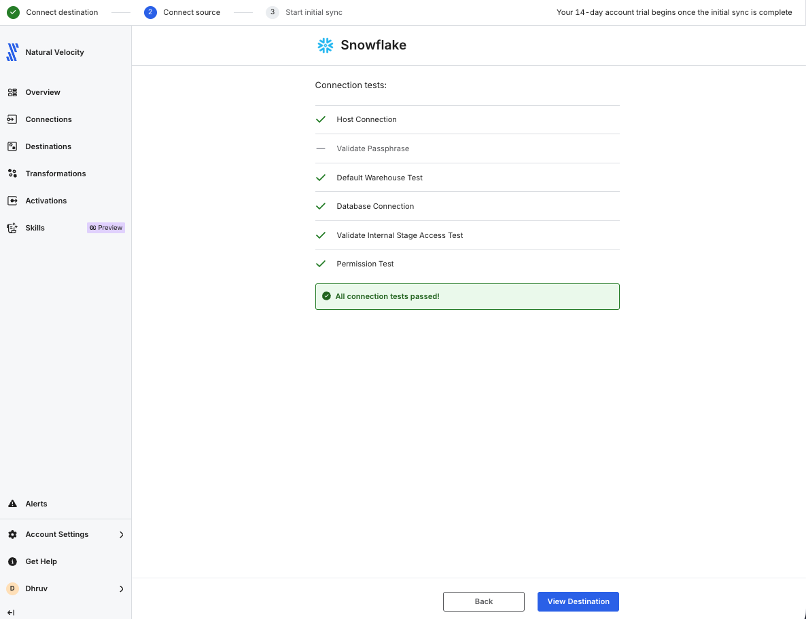
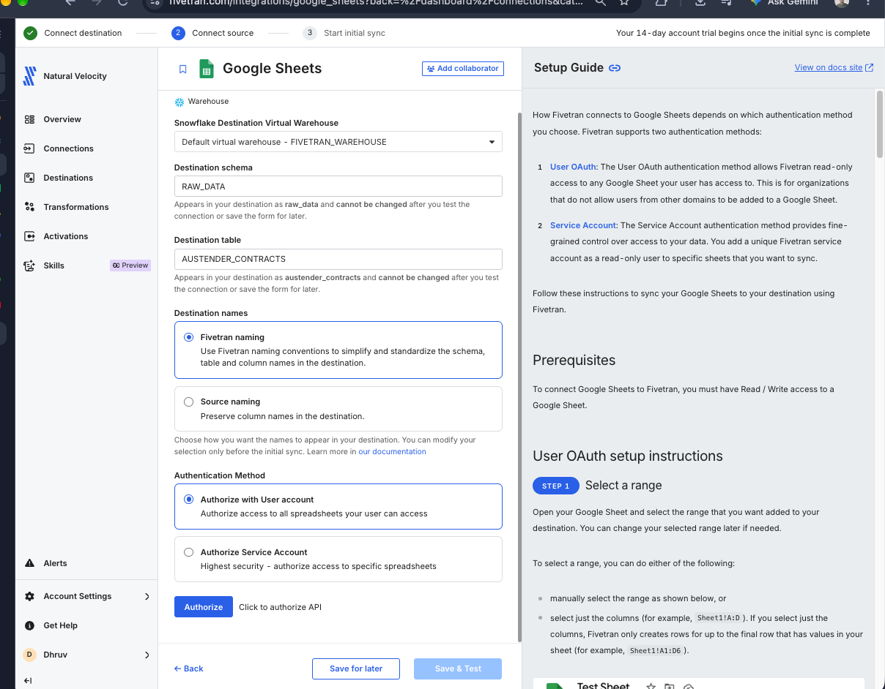
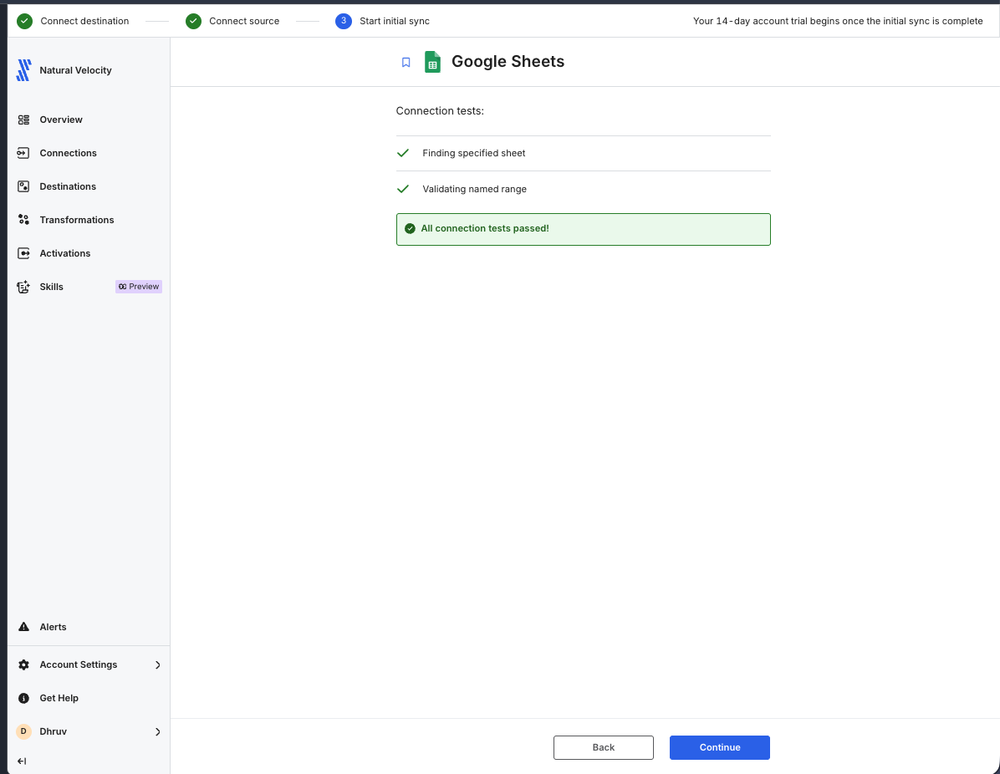
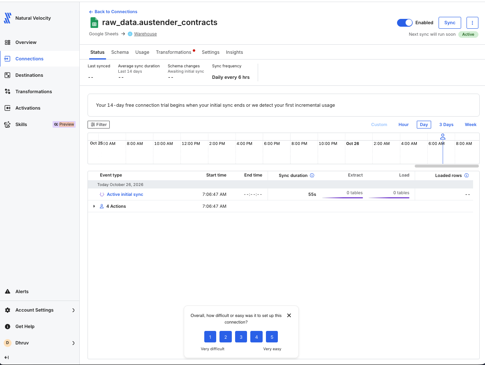
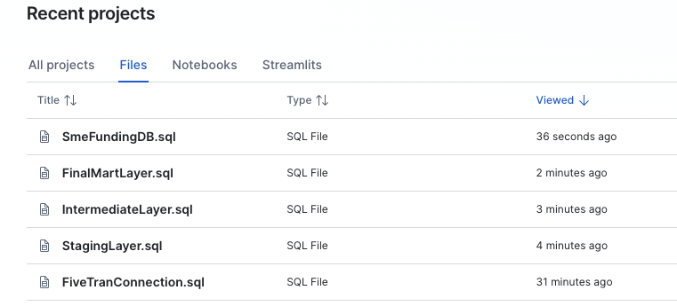
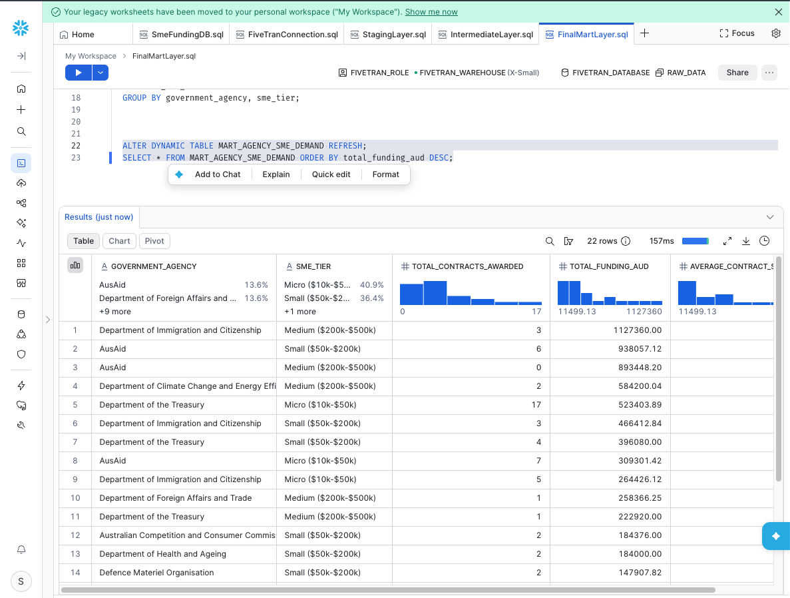

  <h1>Australian SME Government Contract Pipeline</h1>
  
<strong>End-to-End ELT Pipeline: Python, Fivetran, and Snowflake Dynamic Tables</strong>

  

    
    
    
    
    
  

<h3>Why I Built This</h3>

Small and medium businesses (SMEs) often win government contracts but wait 30 to 60 days to get paid. For an SME lender, public contract data is a goldmine: it shows exactly which businesses have guaranteed government cash flow coming in and might need short-term working capital.

The problem is that the Australian government (AusTender) publishes this data in messy, legacy file formats that analysts cannot easily query. I built this automated pipeline to pull those raw files, clean them up, load them into Snowflake, and organize the contracts into loan-sized tiers so a lending or BI team can use the data right away.

<h3>How the Pipeline Works</h3>
<pre>
[data.gov.au API] 
       │
       ▼ (Python / Pandas: Fix encoding & strip Excel formatting)
[Google Sheets] 
       │
       ▼ (Fivetran: Automated 6-hour sync)
[Snowflake: RAW_DATA] 
       │
       ▼ (Snowflake Dynamic Tables: 1-hour target lag)
[Snowflake: Final BI Mart]
</pre>

<h3>Step 1: Fixing the Raw Data (Python & Google Colab)</h3>

When querying the <code>data.gov.au</code> API, the historical contract files are labeled as <code>.xls</code> (Excel), but they are actually tab-separated text files encoded in Windows <code>cp1252</code>. Every text field is also wrapped in literal equals signs and quotes (like <code>="Speedscreen Pty Ltd"</code>) to force Excel formatting.

Instead of dumping broken data into the warehouse, I wrote a Python script in Google Colab to:

<ul>
  <li>Fetch the raw file stream directly from the AusTender storage URL.</li>
  <li>Skip the broken header rows and parse the tab-separated values using <code>cp1252</code> encoding.</li>
  <li>Strip out the <code>=" "</code> characters across all columns using regex.</li>
  <li>Export a clean CSV to stage in Google Sheets.</li>
</ul>

<h3>Step 2: Automated Ingestion (Fivetran to Snowflake)</h3>

To automate data loading without writing custom cron jobs, I connected the staged Google Sheet to Snowflake using Fivetran.

<table>
  <tr>
    <th width="50%">1. Snowflake Role & Warehouse Setup</th>
    <th width="50%">2. Google Sheets Source Mapping</th>
  </tr>
  <tr>
    <td></td>
    <td></td>
  </tr>
  <tr>
    <td align="center"><em>Provisioned a dedicated <code>FIVETRAN_ROLE</code>, user, and X-Small warehouse in Snowflake.</em></td>
    <td align="center"><em>Mapped the cleaned sheet range to land directly in <code>RAW_DATA.AUSTENDER_CONTRACTS</code>.</em></td>
  </tr>
  <tr>
    <th width="50%">3. Source Validation</th>
    <th width="50%">4. Initial Sync Execution</th>
  </tr>
  <tr>
    <td></td>
    <td></td>
  </tr>
  <tr>
    <td align="center"><em>Verified OAuth read access and named range validation.</em></td>
    <td align="center"><em>Completed initial load into Snowflake in 55 seconds on a 6-hour schedule.</em></td>
  </tr>
</table>

<h3>Step 3: Data Modeling (Snowflake Dynamic Tables)</h3>

Once Fivetran drops the data into Snowflake, it needs to be filtered and grouped for the analytics team. Instead of setting up external orchestration for a simple 3-step transformation, I used <strong>Snowflake Dynamic Tables</strong> set to a 1-hour refresh lag.

<table>
  <tr>
    <th width="40%">SQL Workspace Structure</th>
    <th width="60%">How the 3 Layers Work</th>
  </tr>
  <tr>
    <td></td>
    <td>
      
<strong>1. Staging (<code>STG_AU_CONTRACTS</code>)</strong> 
      Renames raw Fivetran columns into clean business terms, casts contract values to <code>NUMBER(38,2)</code>, and removes rows missing supplier names.

      
<strong>2. Intermediate (<code>INT_SME_FUNDING</code>)</strong> 
      Filters out multi-million dollar corporate defense contracts. Keeps only contracts between <strong>$10,000 and $500,000 AUD</strong> and buckets them into three loan tiers:
      <ul>
        <li>Micro ($10k - $50k)</li>
        <li>Small ($50k - $200k)</li>
        <li>Medium ($200k - $500k)</li>
      </ul>
      

      
<strong>3. Final Mart (<code>MART_AGENCY_SME_DEMAND</code>)</strong> 
      Groups the data by Government Agency and SME Tier to calculate total contracts awarded, total funding volume, and average contract size.

    </td>
  </tr>
</table>

<h4>Final Output in Snowflake</h4>

Below is the final query result from <code>MART_AGENCY_SME_DEMAND</code>. An analyst or BI tool can connect directly to this table to see which government departments are spending the most with small businesses.

  

<h3>Repository Files</h3>
<ul>
  <li><code>AusTender_Project/src/AusTenderAPI.ipynb</code>: Google Colab notebook with the API requests and Pandas cleaning code.</li>
  <li><code>AusTender_Project/austender_sme_contracts.csv</code>: The cleaned dataset output from Python.</li>
  <li><code>AusTender_Project/images/</code>: Screenshots of the Fivetran setup, sync logs, and Snowflake query results.</li>
</ul>
